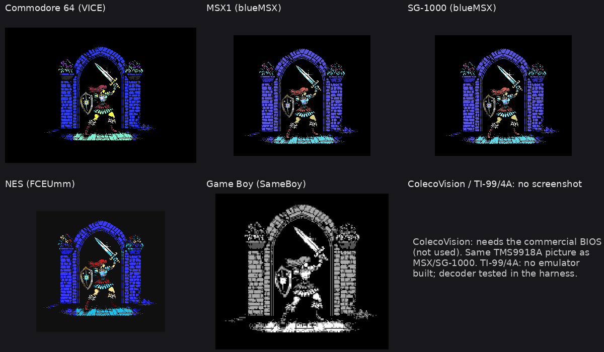

# AMYZ against each machine's usual packers

This compares AMYZ, machine by machine, with the packers most used there. It uses the Warrior
picture and, where it applies, the 200-file corpus: Amy's ColecoVision VRAM data plus the
Warrior pattern and colour tables, 351,896 bytes in all.

`machine-comparison.png` shows the Warrior demo on each machine, as emulator screenshots from the
earlier deliverables:
- C64 in VICE;
- MSX1 and SG-1000 in blueMSX;
- NES in FCEUmm;
- Game Boy in SameBoy.

There is no ColecoVision or TI-99/4A screenshot. The ColecoVision emulators need the
commercial BIOS, which was not used. No TI-99/4A emulator was built.

**Reading the tables.** "Net" is packed data plus decoder plus table. Every decode was
checked byte for byte in a harness. "ms" is the measured cycle count divided by the machine
clock:

| Machine | Clock |
|---|---|
| C64 | 0.985 MHz |
| Z80 machines | 3.58 MHz |
| TI-99/4A | 3.0 MHz, with its wait states |
| NES | 1.79 MHz |
| Game Boy | 4.19 MHz |

All results are MEASURED unless marked otherwise.

This is a later machine-oriented study using a higher-effort AMYZ encoder
search. Its corpus payload totals therefore differ from the frozen 1.0 release
benchmark in the repository root. The stream format and decoders are unchanged;
do not combine rows from the two studies into one ranking.

## Commodore 64 (reused from AMYZPACK-RELEASE, `bench/bench_table.md`)

The Warrior viewer is packed as one runnable `.prg`, so the decoder is included in the size.
Cycles run from SYS to the program start, in the 6502 harness, and the memory result is
byte-identical.

| packer | Warrior .prg (net) | decrunch cycles | ms | 6-program total size | total cycles |
|---|---|---|---|---|---|
| amyzpack (speed 0) | **2954** | 1.31 M | 1331 | **66080** | 14.78 M |
| dali 0.3.5 (ZX0) | 2993 | 0.43 M | 437 | 66335 | 5.68 M |
| Exomizer 2.0.9 | 3016 | 0.90 M | 916 | 66782 | 13.83 M |
| ByteBoozer 2 | 3077 | 0.69 M | 703 | 70168 | 10.98 M |
| amyzpack -fast | 3293 | 0.57 M | 583 | 67995 | 8.45 M |
| TSCrunch 1.3.2 | 3361 | 0.28 M | 281 | 74316 | 3.21 M |

Exomizer 3.1 could not be built: its home, bitbucket.org/magli143/exomizer, was refused by the
proxy (HTTP 403), so Exomizer 2.0.9 from the GitHub archive is used.

## ColecoVision, MSX1, SG-1000 (Z80 + TMS9918A, decoding straight to VRAM)

The ColecoVision has 1 KB of RAM, so only decoders that write straight to VRAM are practical.
Every packer below is run with a VRAM decoder in the Z80 + TMS9918A harness (`vtest_port`,
ports $BE/$BF), and every result is byte-exact.

The encoders were built here from public git sources:
- ZX0 v2.2: einar-saukas/ZX0;
- Pletter 0.5c1: nanochess/pletter;
- aPLib: emmanuel-marty/apultra 1.4.8;
- BitBuster 1.2: abekermsx/BitBuster-1.2, with a small POSIX command-line wrapper;
- LZ4: lz4/lz4, `-12`, raw block;
- Exomizer 2.0.9 `raw`.

**DAN3.** Its repository, AmyPurple/dan3, holds an Emscripten build, `dan3final.c`, that does
not compile natively. DAN3 therefore uses Amy Studio's own JS encoder, from retrocompress-lite.

**Decoders.** The VRAM decoders are Amy Studio's (`src/compression/*_vram.asm`):
- zx0, pletter, aplib, bitbuster, dan3 and exomizer;
- plus the toolkit's ZX0 fast and LZ4 fast;
- plus the AMYZ port decoders.

The corpus timing for MSX1 does not include the extra M1 wait state.

| packer | Warrior packed | decoder | table | **Warrior net** | Warrior decode ms | corpus packed | corpus net | corpus T/B | OK |
|---|---|---|---|---|---|---|---|---|---|
| AMYZ (small) | 2769 | 182 | 15 | **2966** | 934 | **77044** | 77451 | 351.3 | 200/200 |
| ZX0 v2.2 (zx0_vram) | 2849 | 135 | 0 | 2984 | 637 | 81351 | 81486 | 205.4 | 200/200 |
| AMYZ fast | 2769 | 203 | 45 | 3017 | 570 | 77044 | 77922 | 206.1 | 200/200 |
| Exomizer 2.0.9 raw | 2820 | 226 | 0 (+156 B RAM table) | 3046 | 1000 | 80485 | 80711 | 351.6 | 200/200 |
| DAN3 (Amy Studio JS encoder) | 2891 | 205 | 0 | 3096 | 723 | 81516 | 81721 | 248.6 | 200/200 |
| aPLib (apultra) | 2909 | 244 | 0 | 3153 | 593 | 83163 | 83407 | 198.0 | 200/200 |
| BitBuster 1.2 | 3025 | 166 | 0 | 3191 | 564 | 88310 | 88476 | 183.5 | 200/200 |
| Pletter 0.5c1 | 2988 | 212 | 0 | 3200 | 651 | 85229 | 85441 | 210.5 | 200/200 |
| ZX0, fast VRAM decoder | 2849 | 425 | 0 | 3274 | 412 | 81351 | 81776 | 153.7 | 200/200 |
| LZ4 (-12), fast VRAM decoder | 3391 | 419 | 0 | 3810 | 325 | 114349 | 114768 | 118.3 | 200/200 |

"Corpus net" counts the decoder once and one table per game; the corpus has 15 games.

- The decoder sizes leave out the 3-byte `jp` of the test wrappers.
- AMYZ uses the corpus streams, which were encoded with each game's own table. In this table,
  the Warrior pattern stream is 2420 B. The web page encodes the pattern and colour tables
  together with one table, which gives a 2418 B pattern stream.

**Verdict.** AMYZ gives the smallest data on the corpus, 4.3% below the next one. It also gives
the smallest net size for Warrior, 18 B below ZX0. The small decoder is the slowest of the
group, alongside Exomizer. AMYZ fast is about as fast as ZX0 and aPLib, and is still smaller
than all of them on the corpus.

## TI-99/4A (TMS9900 + TMS9918A)

There is no standard packer for the TI-99/4A. Games mostly use nothing, or an in-house RLE.
The baseline here is a plain byte RLE written for this comparison:
- a control byte below 128 means that many literals plus one follow;
- a control byte of 128 or more means a run of 3 to 130 copies of the next byte.

| packer | Warrior packed | decoder | Warrior net | Warrior decode | corpus packed |
|---|---|---|---|---|---|
| AMYZ (`amyz_tms9900.asm`, to VRAM) | 2769 + 15 table | 294 (290 + 4-byte BLWP vector) | 3078 | 516.7 cycles/B with TI wait states: 2116 ms | 77044 |
| plain RLE | 3685 | not written | - | not measured | 153571 |

The AMYZ TMS9900 figures come from the earlier TMS9900 + VDP harness (`harness/tms9900.log`).
No TMS9900 RLE decoder was written, so the RLE row gives data sizes only.

## NES (6502; CHR-RAM through PPU $2006/$2007)

The data is the Warrior v2 conversion: `chr.bin` (8192 B) and `nt.bin` (1024 B).

- **AMYZ and PB53** write straight to the PPU. They were run in the study's
  PPU-model harness plus the released `runnes` harness.
- **ZX0 and aPLib** use the standard 6502 decoders, which write to CPU RAM. They were run
  RAM to RAM in the study harness, with output at $6000. On a NES that means 8 KB of
  cartridge WRAM, then a copy to $2007. That copy is not included or measured.
- **PB53** is the tile codec from pinobatch/240p-test-mini. It is for CHR data only, so it
  has no nametable figure.

| packer | chr | nt | packed (data) | decoder | net | decode cycles | ms |
|---|---|---|---|---|---|---|---|
| AMYZ (`amyz_nes.s`, PPU direct) | 2777 | 429 | 3206 + 15 table | 303 | 3524 | 1.58 M (171.7/B) | 884 |
| ZX0 (zx0 -c, salvador `zx0_6502.asm`, RAM, self-modifying) | 2817 | 434 | 3251 | 196 | **3447** | 0.36 M | 200 + PPU copy |
| aPLib (apultra, Brandwood `aplib_6502.asm`, RAM) | 2867 | 453 | 3320 | 252 | 3572 | 0.44 M | 243 + PPU copy |
| PB53 (240p-test-mini, PPU direct, CHR only) | 3377 | - | 3377 (chr) | 203 | - | 0.32 M (chr) | 180 (chr) |

- **Donut** (jroatch) could not be built: it has no public git repository, only a web page,
  so it was not fetched.
- **LZ4 6502:** no NES LZ4 decoder was taken from a git repository, so there is no LZ4 row.
- **Verdict:** AMYZ has the smallest data, but its net size is 77 B larger than ZX0's. AMYZ is
  also much slower, because it reads matches back through $2007. ZX0 needs 8 KB of WRAM and
  a copy to get the same result.

## Game Boy (SM83)

The data is the Warrior 4-grey conversion: `tiles.bin` (2976 B) and `map.bin` (576 B).
Everything was run in the released SM83 harness
(`examples/warrior-platform-ports/gb/gbtest.c`).

| packer | tiles | map | packed | decoder | net | T-states | ms |
|---|---|---|---|---|---|---|---|
| AMYZ small | 2098 | 238 | 2336 + 15 table | 161 | **2512** | 1.54 M | 367 |
| AMYZ fast | 2098 | 238 | 2336 + 45 table | 204 | 2585 | 0.65 M | 155 |
| pb16 (240p-test-mini `pb16.py` + `unpb16.z80`) | 2567 | 300 | 2867 | 46 | 2913 | 0.24 M | 57 |
| ZX0 v2.2 (data only) | 2134 | 240 | 2374 | no SM83 decoder found | - | - | - |

- No ZX0 port for the Game Boy was found in a public git repository, so the ZX0 row gives
  the data size only.
- pb16's decoder (46 B) is the two routines from `unpb16.z80`. The test wrapper is extra.
- **Verdict:** AMYZ is 401 B smaller net than pb16, and pb16 decodes 2.7 to 6.4 times faster.

## Not tested, and limits

- **Real hardware:** none.
- **VRAM timing on the Z80 decoders:** checked against the harness's 29 T rule only. These
  are Amy Studio's decoders, as she ships them.
- **NES:** ZX0 and aPLib were measured RAM to RAM. The WRAM copy to the PPU is not included.
- **Packers that could not be built here:** Exomizer 3.1, Donut, a native DAN3 build, and a
  Game Boy ZX0 port. LZ4 for 6502 and an RLE decoder for the TI-99/4A were not written.
- **Same tool versions:** the C64 rows reuse the earlier benchmark and were not rerun.

## Evidence in this repository

- `machine-comparison.png` contains the emulator screenshots.
- `../examples/warrior-platform-ports/` contains the MSX1, SG-1000, NES and
  Game Boy sources, ROMs, screenshots and byte-exact AMYZ harness results.
- `../tests/harness/` contains the licensed CPU harness foundations.
- `../decoders/` contains the released AMYZ decoder sources.

The aggregate third-party measurements were supplied with the original study.
Third-party packer and decoder sources are not redistributed here; obtain them
from the repositories and versions named above under their respective licences.
